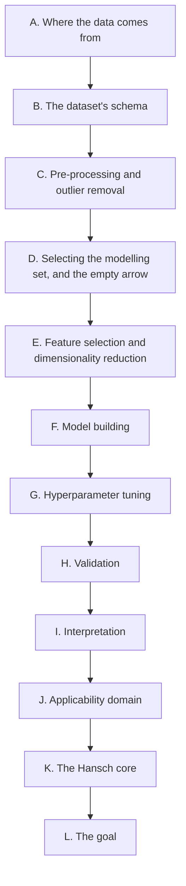

# Whiteboard → notebook mapping

Scene file: `085c29bc-ea35-4ba8-bc04-23b3664609d5.excalidraw`  
SHA-256: `9df310c3598ed2830523026ab22a0010b14d3a999ceeba94b9192501cfb3f812`  
Elements: 1090 172 arrow, 32 diamond, 19 ellipse, 2 frame, 54 freedraw, 17 image, 73 line, 261 rectangle, 460 text

The board was parsed, not eyeballed: `tools/parse_whiteboard.py` reads the element
list and rebuilds the four relations that carry the structure — text bound to a
container, arrows bound to two shapes, group membership and frame membership — then
writes the graph and a card list in reading order. `tools/whiteboard_sections.py`
holds the one interpretive step, and `tools/make_mapping.py` refuses to generate this
file unless all 251 labelled cards are assigned to exactly one stage.

## A. Where the data comes from

A decision tree over sources. It starts at PyTDC / Therapeutic Data Commons and walks a series of questions - group by target receptor, phenotypic side effects, clinical trials, standardised activity values, pharmacokinetic exposure, endpoints not in TDC - to Tox21, ToxCast, ClinTox, SIDER, ChEMBL, and admetSAR 3.0 / QSAR Toolbox. A separate table lists PubChem, ChEMBL, DrugBank, Papyrus, the Harmonized Drug Dataset Quality Control set, and DailyMed.

**Implemented by:** Section 3, cell `source_pull`

| Card | Shape | Position | Label on the board |
| ---: | --- | --- | --- |
| 1 | diamond | (2875,-2933) | How to import the data from TDC for toxicity prediction? |
| 2 | rectangle | (3238,-2787) | Github |
| 3 | rectangle | (3251,-2935) | PyTDC Library |
| 4 | rectangle | (3596,-2935) | Therapeutic Data Commons |
| 5 | rectangle | (3968,-2937) | Tox |
| 6 | rectangle | (4316,-2938) | hERG blockers / Tox21 / Acute Toxicity LD50 / Carcinogens / hERG Central / Skin Reaction / hERG Karim et al. … |
| 7 | diamond | (4684,-2830) | Which dataset to select? |
| 8 | diamond | (5125,-2849) | Group compounds based on target receptor |
| 9 | rectangle | (5550,-2794) | Yes |
| 10 | rectangle | (5777,-2818) | Tox21 |
| 23 | diamond | (5110,-2550) | Understand how side effects manifested at a phenotypica level? |
| 24 | rectangle | (5547,-2662) | No |
| 25 | diamond | (5671,-2646) | Clinical Trials? |
| 26 | rectangle | (5784,-2725) | Toxcast |
| 27 | rectangle | (6087,-2599) | Yes |
| 28 | rectangle | (6270,-2598) | ClinTox |
| 32 | rectangle | (4830,-2427) | SIDER |
| 33 | rectangle | (6084,-2467) | No |
| 34 | diamond | (6209,-2464) | Standardized Activity Values? |
| 35 | rectangle | (6624,-2422) | Yes |
| 36 | diamond | (6764,-2326) | Pharmacokinetics exposure data? |
| 37 | rectangle | (6805,-2424) | Chembl |
| 38 | diamond | (7404,-2333) | Experimental Endpoints not in TDC? |
| 39 | rectangle | (9027,-2364) | Yes |
| 41 | rectangle | (6621,-2290) | No |
| 42 | rectangle | (7131,-2290) | Yes |
| 43 | rectangle | (7172,-2156) | No |
| 44 | rectangle | (7775,-2144) | No |
| 45 | rectangle | (7778,-2276) | Yes |
| 46 | rectangle | (7999,-2210) | QSARToolbox |
| 47 | rectangle | (8000,-2301) | admetsar3.0 |
| 48 | rectangle | (9024,-2232) | No |
| 250 | diamond | (2906,5054) | What sources for getting data? |
| 251 | rectangle | (4785,5072) | S.No. / PubChem ChemBL Drug Bank Papyrus Harmonized Drug DataSet Quality Control Daily Med / Database / 1. / … |

## B. The dataset's schema

One row per drug, carrying an identifier block (PubChem ID, generic name, structural identifier, National Drug Code), an annotation block (FDA label, DrugBank, ATC code) and the two measured blocks, Activity and Tox. The worked example is the ATC code split into its four levels: cimetidine is one code (A / 02 / BA / 01) and mannitol is four, which is the '1 Drug 1 ATC Code?' decision - a drug with several codes becomes several rows.

**Implemented by:** Section 4, cells `schema` and `atc_split`

| Card | Shape | Position | Label on the board |
| ---: | --- | --- | --- |
| 11 | rectangle | (8421,-2949) | Dataset Preparation |
| 12 | ellipse | (8427,-2837) | Snapshot of Dataset |
| 13 | rectangle | (8620,-2891) | Features |
| 14 | rectangle | (8822,-2954) | PubChem ID |
| 15 | rectangle | (8825,-2884) | Generic Name |
| 16 | rectangle | (9411,-2837) | Drug Data |
| 17 | rectangle | (9687,-2847) | Identifier |
| 18 | rectangle | (9976,-2900) | Generic Name |
| 19 | rectangle | (9984,-2823) | Structural Identifier |
| 20 | rectangle | (10220,-2907) | National Drug Code |
| 21 | rectangle | (10260,-2812) | PubChem |
| 22 | rectangle | (10604,-2908) | FDA Label |
| 29 | rectangle | (8806,-2577) | Activity |
| 30 | rectangle | (9959,-2729) | Anatomical Therapeutic Chemical Code |
| 31 | rectangle | (10293,-2701) | Drug Bank |
| 40 | diamond | (10426,-2404) | 1 Drug 1 ATC Code? |
| 54 | rectangle | (9607,-2000) | 0 / Generic Name / ATC Code / ATC Level / 1 / ATC Level / 3 / ATC Level / 2 / ATC Level / 4 / Generic Name / 0 |
| 55 | rectangle | (9680,-1955) | cimetidine |
| 56 | rectangle | (9844,-1958) | AO2BA01 |
| 57 | rectangle | (10637,-1997) | 0 / Generic Name / ATC Code / ATC Level / 1 / ATC Level / 3 / ATC Level / 2 / ATC Level / 4 / Generic Name / … |
| 58 | rectangle | (10709,-1954) | mannitol |
| 59 | rectangle | (10873,-1956) | B05BC01\| B05CX04\|A06AD16\|R05CB16 |
| 68 | rectangle | (9640,-1787) | cimetidine |
| 69 | rectangle | (9832,-1786) | A |
| 70 | rectangle | (10020,-1790) | 02 |
| 71 | rectangle | (10207,-1792) | BA |
| 72 | rectangle | (10396,-1788) | 01 |
| 73 | rectangle | (10670,-1786) | mannitol |
| 74 | rectangle | (10675,-1680) | mannitol |
| 75 | rectangle | (10676,-1733) | mannitol |
| 76 | rectangle | (10861,-1785) | B |
| 77 | rectangle | (10864,-1682) | A |
| 78 | rectangle | (10865,-1735) | B |
| 79 | rectangle | (11049,-1789) | 05 |
| 80 | rectangle | (11057,-1688) | 06 |
| 81 | rectangle | (11058,-1741) | 05 |
| 82 | rectangle | (11236,-1791) | BC |
| 83 | rectangle | (11246,-1686) | AD |
| 84 | rectangle | (11247,-1740) | CX |
| 85 | rectangle | (11425,-1787) | 01 |
| 86 | rectangle | (11434,-1685) | 16 |
| 87 | rectangle | (11435,-1737) | 04 |
| 89 | rectangle | (10678,-1627) | mannitol |
| 90 | rectangle | (10866,-1629) | R |
| 91 | rectangle | (11060,-1635) | 05 |
| 92 | rectangle | (11249,-1633) | CB |
| 93 | rectangle | (11437,-1631) | 16 |
| 96 | diamond | (9242,-1247) | What is the source for SDF? |

## C. Pre-processing and outlier removal

Remove duplicates, drop rows with missing values, standardise. Then two outlier tests with different grounds: a property-rule violation (Rule of 5, Rule of 3, Pfizer's rule) marks a property outlier, and a matched molecular pair inside a congeneric series with a large pIC50 difference marks a structural outlier - an activity cliff. Both are removed, and the board asks for the justification to be written down.

**Implemented by:** Section 5, cells `dedupe_standardise`, `rule_outliers`, `mmp_outliers`

| Card | Shape | Position | Label on the board |
| ---: | --- | --- | --- |
| 49 | rectangle | (3254,-1907) | Removal of Duplicates |
| 50 | diamond | (3546,-2015) | Is any rule(Rule of 5 or Rule of 3, or Pfizer's Rule) violated? |
| 51 | rectangle | (4005,-1908) | Yes |
| 52 | rectangle | (4193,-1936) | Outlier Detected! |
| 53 | rectangle | (4414,-1939) | Remove Outlier |
| 60 | rectangle | (2880,-1843) | Data pre-processing |
| 61 | rectangle | (3262,-1848) | Remove rows with missing values |
| 62 | rectangle | (3268,-1764) | Standardization |
| 63 | rectangle | (4002,-1756) | No |
| 64 | diamond | (4360,-1774) | Matched Molecular Pairs in congeneric series generated using molecular fingerprinting in mmpdb with large pIC… |
| 65 | rectangle | (4963,-1686) | Yes |
| 66 | rectangle | (5155,-1721) | Outlier Structural Detected |
| 67 | rectangle | (5377,-1716) | Remove Outlier |
| 88 | rectangle | (4960,-1534) | No |
| 125 | diamond | (8670,265) | Workflow for dataset preprocessing and justification for outlier removal? |

## D. Selecting the modelling set, and the empty arrow

Three selection criteria: a common target, standardised units, orthogonal assay data. The target variable is the Therapeutic Index. One box - 'What are the properties/structural features?' - has an arrow leading out of it and nothing on the end: this is the box left for me to fill. A second open question asks what happens if toxicity is used as a predictor of activity.

**Implemented by:** Section 6, cells `select_series`, `substituent_constants`, `descriptor_block`

| Card | Shape | Position | Label on the board |
| ---: | --- | --- | --- |
| 104 | rectangle | (8649,-717) | Dataset |
| 105 | rectangle | (10373,-653) | Selection Criteria 1. Common Target 2. Standardized Units 3. Orthogonal Assay Data |
| 106 | diamond | (11221,-756) | What are the properties/structural features? |
| 108 | diamond | (8723,-408) | What is the target variable? |
| 112 | rectangle | (9220,-235) | Therapeutic Index |
| 247 | rectangle | (3904,4800) | What happens if toxicity is added as as a predictor for activity? |

## E. Feature selection and dimensionality reduction

Feature selection by a genetic algorithm whose objective minimises pairwise intercorrelation. Dimensionality reduction is a yes/no branch over PCA, LDA and t-SNE (deeptime, openTSNE). Descriptors come from the MORDRED library.

**Implemented by:** Section 6, cells `select_series`, `substituent_constants`, `descriptor_block`; Section 7, cells `tier1_hansch`, `tier1_diagnostics`, `williams`

| Card | Shape | Position | Label on the board |
| ---: | --- | --- | --- |
| 109 | diamond | (11653,-359) | Dimensionality Reduction? |
| 110 | rectangle | (12764,-386) | Algorithms Principal Component Analysis Linear Discriminant Analysis t-SNE |
| 111 | rectangle | (13359,-395) | Dependencies deeptime python library opentsne |
| 113 | diamond | (10904,-327) | Feature Selection Methodology? |
| 114 | rectangle | (12400,-260) | Yes |
| 119 | rectangle | (10936,43) | Genetic Algorithm with objective function that minimizes pairwise intercorrelation |
| 120 | rectangle | (12396,-1) | No |
| 149 | rectangle | (4190,1566) | QSAR Descriptors MORDRED Py Library |

## F. Model building

Two columns, regression for a continuous target and classification for a discrete one, each with its dependencies named. The regression column is led by 'Hansch Analysis based Multi Linear Regression' and continues through principal component regression, PLS and kernel PLS, SVR with a Gaussian kernel, random forest, gradient boosting, MLP and a graph neural network. Libraries: QSPRpred, QSAR-Co-X, PyQSAR3.

**Implemented by:** Section 7, cells `tier1_hansch`, `tier1_diagnostics`, `williams`; Section 8, cell `tier2_free_wilson`; Section 9, cell `tier3_lser`; Section 10, cells `tier4_align`, `tier4_comfa`; Section 11, cells `tier5_ml`, `tier5_shap`

| Card | Shape | Position | Label on the board |
| ---: | --- | --- | --- |
| 95 | rectangle | (5890,-1274) | Random Forest Classifier / Quadratic Discriminant Analysis Canonical Discriminant Analysis / Reference: 1. Ca… |
| 97 | rectangle | (16250,-1240) | Deep Learning / Classification(discrete Target Variable) / sklearn.svm.SVC / Partial Least Squares Linear Dis… |
| 98 | rectangle | (16991,-1242) | Dependencies / sklearn.ensemble.RandomForestClassifier / xgboost.XGBClassifier / sklearn.neural_network.MLPCl… |
| 100 | diamond | (14070,-1142) | Model Building Methodology / Hansch Analysis based Multi Linear Regression / Principal Component Regression /… |
| 101 | rectangle | (14851,-1189) | Regression(continuous Target Variable) / sklearn.cross_decomposition.PLSRegression / Partial Least Squares Re… |
| 102 | rectangle | (15591,-1192) | Linear Discriminant Analysis / Gradient Boost Classifier Support Vector Classifier / Dependencies / sklearn.l… |
| 103 | rectangle | (17754,-1121) | Libraries and Software / QSPR Pred QSAR Co X PyQSAR3 |
| 94 | image | (3233,-1298) | STAGE 2 / predict / predict / predict / Preprocessing(Standardization of toxicological parameters(IC50,LC50,L… |

## G. Hyperparameter tuning

Optuna, with median pruning and successive halving.

**Implemented by:** Section 11, cells `tier5_ml`, `tier5_shap`

| Card | Shape | Position | Label on the board |
| ---: | --- | --- | --- |
| 107 | ellipse | (14738,-556) | Using Optuna for optimized hyperparameter tuning |
| 115 | diamond | (14203,-300) | Hyperparameter Tuning Methodology |
| 121 | rectangle | (15551,-20) | Median Pruning |
| 122 | rectangle | (15560,110) | Successive Halving |

## H. Validation

Internal validation by Y-randomisation, k-fold, nested cross-validation, leave-one-out and leave-many-out, reported as R-squared, Q-squared and RMSE. External validation by the concordance correlation coefficient, citing Chirico and Gramatica 2011. The split is a scaffold split: Morgan fingerprints, Bemis-Murcko scaffolds and a Tanimoto cutoff so test molecules are not too similar to training ones, with Group K-Fold over the clusters; eight clustering methods are listed, and each cluster is to be checked against a co-crystallised ligand from the PDB.

**Implemented by:** Section 13, cells `y_randomisation`, `external_ccc`; Section 12, cell `repeated_cv`

| Card | Shape | Position | Label on the board |
| ---: | --- | --- | --- |
| 116 | diamond | (16381,-266) | Model Validation Methodology |
| 117 | rectangle | (16939,-305) | Internal Validation Y Randomization, K-Cross Fold Validation, Nested Cross Validation(useful_rdkit_utils.cros… |
| 118 | rectangle | (17538,-305) | Leave One Out CV Leave Many Out CV R^2 Q^2 Root mean Squared error |
| 123 | rectangle | (16969,36) | External Validation |
| 124 | rectangle | (17552,44) | Concordance correlation coefficient / Chirico N, Gramatica P. Real external predictivity of QSAR models: How … |
| 150 | diamond | (8650,1618) | For internal validation, How was the dataset split into Train and Test? |
| 153 | rectangle | (9440,1672) | 1. / Reference: Hurtado-Pachon, Jonathan; Peña-Varas, Carlos; Ramírez, David. Chemoinformatics analysis for c… |
| 154 | rectangle | (9560,1785) | Morgan Fingerprint Generation -> Scaffold splitting strategy using Bemis Murcko and Tanimoto Similarity ( A c… |
| 155 | rectangle | (10172,1662) | Methodologies |
| 156 | rectangle | (10600,1764) | 2. / 3. |
| 157 | rectangle | (10776,1804) | Group KFold Shuffle |
| 161 | rectangle | (11803,1934) | Metric / Tukey's Honestly Significant Difference |
| 162 | rectangle | (12577,2001) | Dependencies / useful_rdkit_utils |
| 164 | rectangle | (8081,2197) | References: https://practicalcheminformatics.blogspot.com/2024/11/some-thoughts- on-splitting-chemical.html?m… |
| 165 | diamond | (9709,2459) | S / Split ? |
| 166 | rectangle | (9922,2464) | Check Tanimoto Similarity between Morgan Fingerprints |
| 167 | rectangle | (10364,2386) | Each cluster is validated against a co-crystallized ligand with the target of interest from PDB |
| 129 | rectangle | (9765,763) | 1. K means 2. Kennard Stone 3. Agglomerative Clustering 4. Bemis-Murcko 5. Taylor Butina Clustering 6. Kohone… |
| 133 | diamond | (8765,933) | Spotting Patterns in Dataset |
| 134 | rectangle | (10939,925) | Structural Distance Metrics |
| 135 | rectangle | (11763,899) | Dependencies / Datamol Rdkit(mols2grid for visualising clusters) |

## I. Interpretation

SHAP, Morgan fingerprint similarity maps, a structure-activity landscape index, and Hansch-based mechanistic interpretation.

**Implemented by:** Section 7, cells `tier1_hansch`, `tier1_diagnostics`, `williams`; Section 11, cells `tier5_ml`, `tier5_shap`

| Card | Shape | Position | Label on the board |
| ---: | --- | --- | --- |
| 126 | diamond | (14326,452) | Model Interpretation Methodology |
| 127 | rectangle | (14898,511) | S / SHAP |
| 128 | rectangle | (15150,504) | Cao, Jinhui, and Yanli Liu. "Multi-objective QSAR prediction of ERα antagonists via SHAP-based interpretation… |
| 130 | rectangle | (14903,673) | Morgan Fingerprint Similarity Maps |
| 131 | rectangle | (15417,683) | https://patwalters.github.io/practicalchemin formatics/jupyter/ml/interpretability/2021/ 06/03/interpretable.… |
| 136 | rectangle | (14737,941) | Structural Activity Landscape Index |
| 137 | rectangle | (14841,795) | Hansch Analysis based Mechanistic Interpretation |

## J. Applicability domain

Five metrics: hat leverage, autoencoder error in SMILES reconstruction, a percentile bounding box over the feature distribution, an envelope method and a distance method.

**Implemented by:** Section 14, cell `applicability_domain`

| Card | Shape | Position | Label on the board |
| ---: | --- | --- | --- |
| 146 | ellipse | (14358,1231) | Applicability Domain |
| 147 | rectangle | (14859,1262) | Metrics 1.Hat Leverage 2. AutoEncoder Error in SMILE Reconstruction 3. Percentile bounding box based on distr… |
| 148 | rectangle | (15312,1325) | References: https://scikit- fingerprints.readthedocs.io/v1 .17.0/modules/applicability_do main.html https://o… |

## K. The Hansch core

The theory, drawn out. Dose-response is sigmoidal with a linear region; AC50 is read off it and the response variable is log(1/C), or log of the reciprocal of the minimum effective concentration when the response is binary. Binding energy is the natural log of the association constant, so a lower AC50 means tighter binding and a more negative binding-energy change. The linear free-energy assumption: the total change in binding energy is the sum of the hydrophobic, electronic and steric contributions of a substituent, with the parabola in log P because a drug must be water-soluble enough to travel and lipid-soluble enough to enter cells. Hammett's constant is positive for electron-withdrawing groups; the Taft steric factor is negative for bulky ones. The equation is written out as log(1/C) = -a(logP)^2 + b logP + c*sigma + d*Es + error. Two caveats are written on the board: the relationship needs enough aqueous solubility, and molecules in one congeneric series can still show activity cliffs. A third says Hansch results should be checked against binding-energy changes from docking.

**Implemented by:** Section 7, cells `tier1_hansch`, `tier1_diagnostics`, `williams`; Section 8, cell `tier2_free_wilson`

| Card | Shape | Position | Label on the board |
| ---: | --- | --- | --- |
| 138 | rectangle | (2970,1048) | Rule based classifier |
| 139 | rectangle | (4036,1105) | New Drugs |
| 140 | rectangle | (4299,1101) | Tox |
| 141 | rectangle | (4363,1015) | Hansch Analysis |
| 142 | rectangle | (4629,1012) | Classifier |
| 143 | rectangle | (3747,1230) | Lipophilicity |
| 144 | rectangle | (4042,1228) | Biological Activity |
| 145 | ellipse | (4062,1376) | QSAR |
| 151 | diamond | (3839,1819) | Satisifies Pfizer 3/75 Rule? |
| 152 | diamond | (4393,1689) | Significant difference in dose corrected bioavailability? |
| 158 | diamond | (3343,2039) | hybridize? |
| 159 | rectangle | (4625,2086) | Drugs with Toxicity Endpoints |
| 160 | rectangle | (4674,1944) | Toxicity |
| 163 | rectangle | (4408,2109) | Bioavailability(fraction absorbed/not metabolized) = |
| 217 | rectangle | (2857,3752) | Concentration of drug / log Response / Concentration of drug / 50% / Biological Activity / For same drug, Wha… |
| 218 | rectangle | (2873,3770) | Change in binding energy / Natural Logarithm of the Association Constant(Equilibrium constant) |
| 219 | rectangle | (3754,3756) | Lower the AC50, Higher Potency/Activity , tighter the binding , more negative the change in binding energy. |
| 224 | rectangle | (2961,3906) | Inverse Relationship |
| 225 | rectangle | (3382,3897) | Sigmoidal Relationship |
| 226 | rectangle | (3529,4029) | Linear Region |
| 227 | rectangle | (3738,3963) | Assumption: Hansch Analysis requires sufficient solubility in water so the drug can be transported in the blo… |
| 229 | diamond | (3296,4161) | Is the response variable binary? |
| 230 | rectangle | (3534,4078) | AC50 |
| 231 | rectangle | (3626,4288) | Yes |
| 232 | rectangle | (3628,4185) | No |
| 233 | rectangle | (3774,4144) | Logarithm of the Reciprocal of the AC50 Logarithm of the Reciprocal of Minimum Concentration at which Respons… |
| 235 | rectangle | (2924,4394) | Change in log octanol water partition coefficient / Applying the Linear Free energy Theorem, the total change… |
| 236 | rectangle | (3740,4412) | Assumption: Molecules with similar target will have similar scaffold and similar activity. Activity Cliffs(Mo… |
| 237 | rectangle | (4281,4298) | In which drugs, a response is observed at the given dose? |
| 240 | rectangle | (3020,4557) | Inverse Relationship |
| 241 | ellipse | (3372,4539) | Binding energy changes linearly with change in electronic properties(Hammet Constant is positive for electron… |
| 242 | rectangle | (3736,4567) | Structure Activity Relationships determined via Hansch Analysis need to be validated by calculating change in… |
| 243 | rectangle | (3739,4695) | log(1/C) = -a(log P) + b log P + (c x Hammett Constant) + ( d x Taft Steric Factor) + Error Term / 2 |
| 244 | rectangle | (4043,4702) | Hansch Equation |
| 132 | rectangle | (3973,918) | Reinvent4 by AstraZeneca |

## L. The goal

'Build and Integrate Multiple Local QSAR models into a single Global QSAR model for prediction within a therapeutically diverse dataset (Different Anatomical Therapeutic Chemical Code Levels) curated by Paccanaro Research Labs', written twice, with the Galeano and Paccanaro 2022 Cell Reports Methods paper cited.

**Implemented by:** Section 2, markdown `goal`, and Section 15, cell `comparison_table`

| Card | Shape | Position | Label on the board |
| ---: | --- | --- | --- |
| 246 | rectangle | (2966,4904) | Goal 1: Build and Integrate Multiple Local QSAR models into a single Global QSAR model for prediction within … |
| 248 | rectangle | (4477,4905) | Goal 1: Build and Integrate Multiple Local QSAR models into a single Global QSAR model for prediction within … |
| 99 | rectangle | (9967,-1107) | 1. Diego Galeano, Alberto Paccanaro Machine learning prediction of side effects for drugs in clinical trials.… |

## Out of scope here: clinical trials, pharmacokinetics and epidemiology

A large block of study notes alongside the pipeline: clearance and AUC, relative bioavailability, trial design (randomisation, placebo, double blind, open label, phase 1), reading relative risk claims honestly, four models for paying trial participants, and prevalence against incidence.

**Not implemented.** These cards are about clinical trial conduct and epidemiology, not about fitting or validating a QSAR model. Nothing in them feeds a descriptor, an endpoint or a validation step, so the notebook does not implement them. They are listed here so it is clear they were read and not missed.

| Card | Shape | Position | Label on the board |
| ---: | --- | --- | --- |
| 168 | rectangle | (3011,2874) | Mg of drug measured in renal output = / Clearance X AUC / IV / T / IV / T / T / inhalation / T / 0 / 50 / 90 … |
| 169 | rectangle | (3183,2939) | Drug 1(Toxicity) |
| 170 | rectangle | (3550,2936) | Drug 1(No Toxicity) |
| 171 | rectangle | (3981,2865) | Therapeutic dosage range to be given to clinical trial participants has been calculated based on the No Obser… |
| 172 | rectangle | (4406,2888) | Which performs better? |
| 173 | rectangle | (5228,2848) | Scientific Reality Check |
| 174 | rectangle | (5375,2861) | Hype: This medication reduces the risk of hospitalization by 33% |
| 175 | rectangle | (5932,2870) | Scientific Reality Check |
| 176 | rectangle | (6498,2872) | Types of Models for compensating Clinical Trial participants |
| 177 | rectangle | (7786,2876) | The prevalence is the proportion of people with the disease or disease burden in the target population(only u… |
| 178 | rectangle | (3981,3157) | Patients are randomly allocated into treatment and control to prevent selection bias. Patients in the treatme… |
| 179 | rectangle | (4288,3055) | New Treatment |
| 180 | ellipse | (4631,3139) | Placebo must be the best treatment available! If no treatment then, an inactive formulation of the new treatm… |
| 181 | rectangle | (4691,3049) | Placebo |
| 182 | rectangle | (5240,3026) | 33 out of 100 |
| 183 | rectangle | (5562,3037) | 33 out of 100 / 33 out of 100 |
| 184 | rectangle | (5900,3140) | 3 % |
| 185 | rectangle | (6198,3144) | 2 % |
| 186 | rectangle | (6529,3100) | Market Model |
| 187 | rectangle | (6839,3098) | Wage Model |
| 188 | rectangle | (7147,3102) | Reimbursement Model |
| 189 | rectangle | (7470,3104) | Appreciation Model |
| 190 | rectangle | (3066,3278) | Clearance(Drug specific) = / L of renal output X Elimination Rate constant / Rate at which drug = cleared out… |
| 191 | rectangle | (3068,3239) | Mg of drug measured = Integral of the product of Mg/L of drug measured in renal in renal output output and L … |
| 192 | rectangle | (3070,3325) | AUC(Mode of Delivery specific ) = / Integral of the Mg/L of drug measured in renal output with respect to tim… |
| 193 | rectangle | (3983,3338) | The focus of the clinical trial is testing whether the new treatment improves patient quality of life rather … |
| 194 | rectangle | (3983,3297) | Population of patients undergoing clinical trial should be representative of minority groups! |
| 195 | rectangle | (3987,3250) | Double blind clinical trials must be reproduced by independent researchers to be clinically validated! |
| 196 | rectangle | (3992,3386) | : Undesirable side effect temporally associated with the use of medicine. Need not be causal. / Adverse Event |
| 197 | rectangle | (3992,3194) | : No one including the researchers or the patients knows who is in the treatment and control group! / Double … |
| 198 | rectangle | (4689,3255) | : Study of what body does to medicine eg. ADME / Pharmacokinetics |
| 199 | rectangle | (4693,3302) | : Study of the mechanism of action of medicine in the body. / Pharmacodynamics |
| 200 | rectangle | (4697,3356) | Phase 1 clinical trials analyze pharmacokinetics and pharmacodynamics |
| 201 | rectangle | (4720,3405) | Biological Medicine is synthesized from biological sources eg. whole blood components from animals. Small Mol… |
| 202 | rectangle | (5247,3240) | 33 out of 100 People actually benefitted |
| 203 | rectangle | (5384,3316) | Hype: This medication decreases within 5 year mortality by 50%. |
| 204 | rectangle | (5864,3231) | 1 out of 100 People actually benefitted |
| 205 | rectangle | (6582,3377) | Supply and Demand More people willing to participate lower pay |
| 206 | rectangle | (6879,3366) | Egalitarianism :People doing the same work should be paid equally. |
| 207 | rectangle | (7214,3299) | Participants are reimbursed for food,travel expenses and opportunity cost. |
| 208 | rectangle | (7516,3386) | Payment at the end of study for selfless service to science. |
| 209 | rectangle | (8879,3218) | Walking in snow with light clothes |
| 210 | rectangle | (3059,3453) | AUC oral / AUC inhalation / Relative bioavailability = / For identical doses of same drug in same patient, |
| 211 | rectangle | (3982,3493) | : Every patient(therapeutic potential has already been established so no need for control) receives the new t… |
| 212 | rectangle | (5258,3529) | 50 out of 100 |
| 213 | rectangle | (5608,3543) | 50 out of 100 |
| 214 | rectangle | (5851,3619) | 50 out of 100 people who were going to die within 5 years survived 0.01 additional years. |
| 215 | rectangle | (6578,3594) | Monetary incentives for adherence and trial completion |
| 216 | rectangle | (6879,3594) | Fixed wage for all participants but compensation given for risky procedures. |
| 220 | rectangle | (5295,3710) | 50 out of 100 People actually benefitted |
| 221 | rectangle | (7205,3635) | No compensation for risky procedures. |
| 222 | rectangle | (7787,3799) | The incidence is the rate of new cases in the population at risk(does not include people who have got the dis… |
| 223 | diamond | (8328,3772) | Is each person exposed to the risk factor for same time? |
| 228 | rectangle | (8937,3949) | Yes |
| 234 | rectangle | (8934,4075) | No |
| 238 | rectangle | (8507,4316) | Relation between Prevalence and Incidence |
| 239 | rectangle | (9565,4295) | Incidence = 3 person months at risk / 87 |
| 245 | rectangle | (8471,4544) | Prevalence = Incidence X Average Survival Time (total cases) (no. of new cases) |
| 249 | ellipse | (8519,4736) | Assumes incidence does not change with time |
